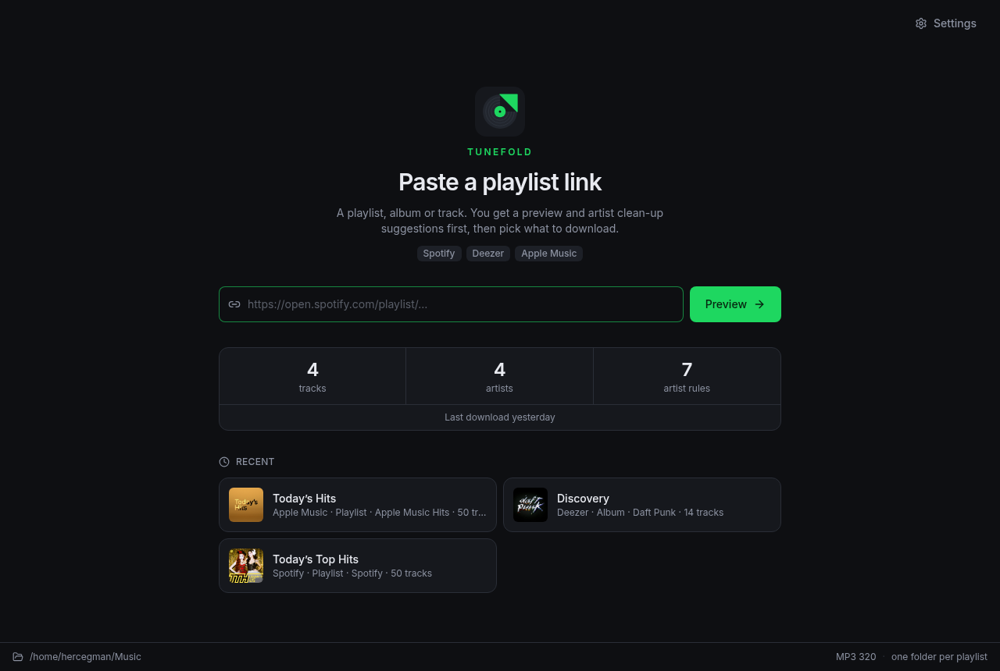
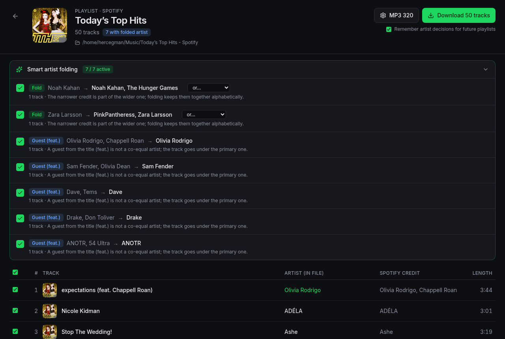
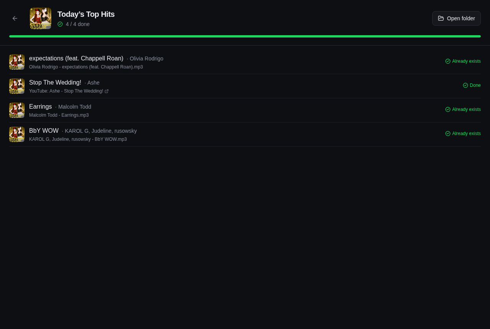
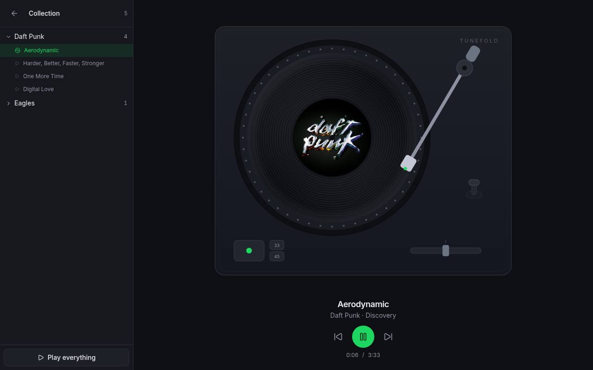
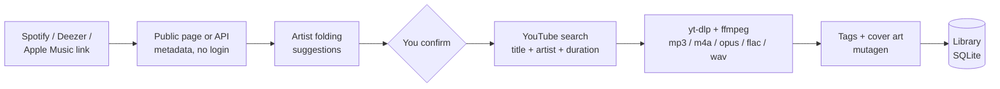
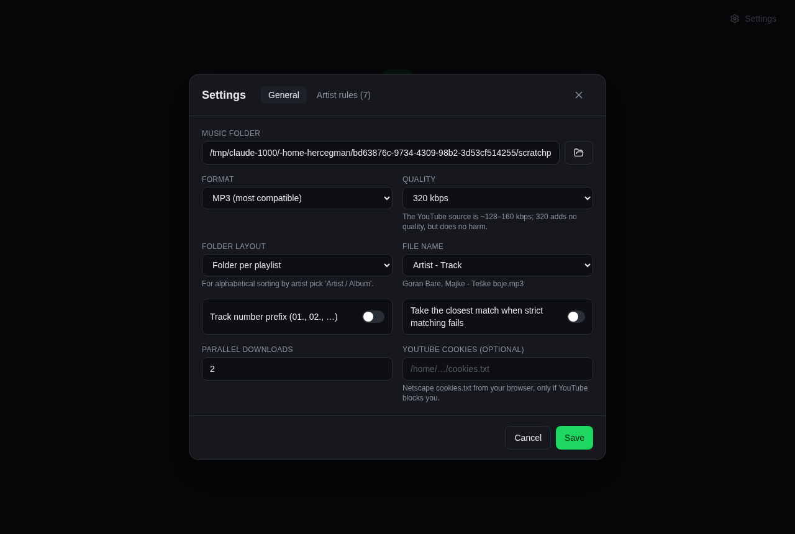

<div align="center">



# Tunefold

**Turn Spotify, Deezer and Apple Music playlists into neatly tagged audio files. Fold messy artist credits into one clean name, then play the result on a turntable.**

[](LICENSE)
[](#build)
[](https://tauri.app)
[](https://react.dev)
[](https://python.org)
[](https://github.com/yt-dlp/yt-dlp)

[Why](#why-tunefold) · [Features](#features) · [Player](#the-turntable) · [Open with](#opening-files-from-the-desktop) · [Updates](#updates) · [Compared](#compared-to-other-downloaders) · [How it works](#how-it-works) · [Quick start](#quick-start) · [Build](#build) · [Architecture](#architecture) · [Roadmap](#roadmap)

</div>

---

## Why Tunefold

A streaming catalogue credits the same artist differently from album to album.
Some songs are filed under **Silk Sonic**, others under **Bruno Mars, Anderson
.Paak, Silk Sonic**. Some under **Beyoncé**, others under **Beyonce**. A guest
on one track turns **Olivia Rodrigo** into **Olivia Rodrigo, Chappell Roan**.
And the three catalogues Tunefold reads do not agree with each other either.

Download that playlist with any ordinary tool and your library, sorted by
artist, is scattered across three folders for one band.

Tunefold reads the playlist first, spots those credits, and **suggests one
canonical name for each artist**. You confirm with a click, rename, or decline.
The decision is remembered and applied to every playlist after that.

<div align="center">

</div>

## Features

- **Three catalogues, one window.** Paste a link from any of them - no account, no API key, nothing to configure:
  | Source | Links it takes |
  | :--- | :--- |
  | Spotify | `open.spotify.com/playlist\|album\|track/…`, `spotify:album:…` |
  | Deezer | `deezer.com/…/playlist\|album\|track/…`, `deezer.page.link/…` short links |
  | Apple Music | `music.apple.com/…/playlist\|album\|song/…`, including `?i=` song links |
- **Playlists, albums and single tracks** from any of the three.
- **Preview before download.** See every track, its own album art, its credit, the name it will be saved under, and what you already have. Pick exactly what you want.
- **Smart artist folding.** Four kinds of suggestions, all driven by the names people actually see:
  | Kind | Example | Rule |
  | :--- | :--- | :--- |
  | Fold | `Silk Sonic` → `Bruno Mars, Anderson .Paak, Silk Sonic` | a narrower credit is part of a wider one, so everything goes under the wider name (the reverse is one click away) |
  | Guest | `Olivia Rodrigo, Chappell Roan` → `Olivia Rodrigo` | a `(feat. X)` in the title is a guest, not a co-equal artist |
  | Spelling | `Beyonce` → `Beyoncé`, `Panic at the Disco` → `Panic! At The Disco` | same name, different case, diacritics or punctuation |
  | Saved rule | applied automatically | a decision you made on an earlier playlist |
- **Correct tags, everywhere.** Title, artist, album artist, album, year, track number and front cover, written as ID3v2.3 for MP3 so car head units and old players read them too. The credit the source printed is kept in a separate `ORIGINAL_ARTISTS` tag, so nothing is lost.
- **Accurate matching.** The YouTube upload is chosen by title, artist and duration, not by the first hit and not by view count. A title that says live, remix, cover or sped-up loses to a clean one - unless the track itself asks for it, so a playlist entry named `… - Live at Wembley` fetches the live take and not the studio cut. Hotel California is the test case: the 1977 live video outranks the studio recording on YouTube eight to one, and Tunefold still takes the studio album version the playlist actually names.
- **…and the last word is yours.** Every upload the search found stays on the download screen under **Other versions**, with length, views, channel and a badge for what each one is. Pick another and that track is fetched again; search YouTube differently or paste a link if the right one never showed up. The choice is remembered per track, so the same song in a later playlist goes straight to it.
- **Five formats.** MP3, M4A, Opus (128 to 320 kbps) and FLAC or WAV (lossless).
- **Your layout.** One folder per playlist, `Artist/`, or `Artist/Album/`. File names as `Artist - Track`, `Track - Artist` or just `Track`, with optional `01.` prefixes.
- **Resumable.** Tracks already on disk are skipped. Stop any time, retry only what failed.
- **It retries by itself.** YouTube hands out signed URLs that go stale, and a 403 mid-playlist is routine. Each download re-extracts a fresh URL before giving up, and anything still refused waits for a second pass once the rest are done and nothing is competing for bandwidth. The row says so - "Retrying at the end" - instead of showing you an HTTP code. Errors that will never pass, like a private video, fail straight away.
- **Parallel downloads** with live per-track progress.
- **A turntable, not a track list.** What you downloaded plays in the app, filed under the folded artist name - see [the turntable](#the-turntable). A real transport with it: a progress bar you can drag, shuffle, repeat the queue or the track, volume, and keyboard shortcuts from any screen.
- **It updates itself.** On start-up Tunefold asks GitHub whether there is a newer release and, if there is, says so in a strip at the top with the release notes. One button downloads it, installs it and restarts - nothing happens without that press, and a version you wave off is not mentioned again. Every update is signed, and a build will not install one it cannot verify. See [updates](#updates).
- **A player for the whole machine.** Tunefold registers itself as an audio handler, so any MP3, M4A, FLAC, Opus, WAV, OGG or AAC file on the computer can be opened in it - and opening one track queues the rest of its folder behind it. A second file opened while Tunefold is running goes to the window that is already playing instead of starting a second copy. See [opening files from the desktop](#opening-files-from-the-desktop).
- **Back goes back.** The arrow and Escape step one screen back, and so do the webview's own back gestures, which an app without a history stack silently swallows. Leaving a running download no longer cancels it or reloads the playlist - the Download button on the preview leads straight back in.

<div align="center">

</div>

## The turntable

<div align="center">

</div>

The sidebar is the point of the whole app made visible: one entry per artist,
under the name **you** confirmed, not the credit three different services
printed. It is read from the download history, so it only ever lists files that
are still on disk.

The arm is the progress bar. It starts on the outer groove and travels inward
as the side plays, the way a record actually does, and dragging it scrubs.
The platter turns at 33⅓ rpm - 1.8 seconds a revolution, the real figure -
spinning up and coasting down instead of snapping between states. When a track
ends the arm lifts, a new record drops onto the platter and the arm sets back
down on the outer groove. The audio never waits for any of that: the next track
starts immediately and the choreography plays over it.

The label in the middle is the cover art read out of the file's own tags, so it
works offline and for everything downloaded before there was a player.

Everything else on the deck is there too, and some of it works: the start/stop
button and the cue lever both play and pause, 33 and 45 change how fast the
platter turns, and the stylus lifts off the record whenever playback stops. The
counterweight, the anti-skate dial, the pitch fader, the target light and the
45 adapter on its post are furniture - a deck looks like a deck. A record with
no cover art gets its name printed round the label instead.

Under the deck is the transport the arm cannot do on its own: a progress bar to
drag, **shuffle**, **repeat** (the queue, or one track), volume, and how far
through the queue you are. Shuffling re-orders what has not played yet and
leaves the record that is playing on the deck. Shuffle, repeat and volume are
remembered between sessions.

Playing something and then leaving the screen keeps it playing, with a strip
along the bottom that has the same controls and the same progress bar. The
shortcuts work on every screen:

| Key | |
| :--- | :--- |
| `Space` | play / pause |
| `←` `→` | seek 5 seconds |
| `↑` `↓` | volume |
| `N` / `P` | next / previous |
| `S` | shuffle |
| `R` | repeat: off → queue → one track |
| `M` | mute |

`prefers-reduced-motion` turns the animation off.

> **Linux:** the window decodes audio through GStreamer rather than carrying its
> own decoders, so a machine without the plugin packages cannot play an MP3
> however healthy the file is. The `.deb` and `.rpm` ask for them; for the
> AppImage, or on Arch, install them yourself:
> `gst-plugins-good gst-plugins-bad gst-plugins-ugly gst-libav`
> (`gstreamer1.0-*` on Debian and Ubuntu). The player says so when it hits this
> rather than sitting there silently.

## Opening files from the desktop

Tunefold claims the audio types it can play, so it appears under **Open with**
for any audio file on the machine - not only for what it downloaded itself.
Open one track and the rest of the folder queues behind it in name order; select
several and you get exactly those. Titles come from the file's own tags, and
from the file name when there are none.

The `.deb`, `.rpm`, `.msi` and `.dmg` register the file types when they install.
For an AppImage, or a local build, there is nothing installed to register, so:

```bash
python scripts/install_desktop.py path/to/Tunefold.AppImage
python scripts/install_desktop.py --default      # and make it the handler
python scripts/install_desktop.py --uninstall
```

Opening a file while Tunefold is already running does not start a second copy:
the new process hands the paths to the window that is already playing, focuses
it, and exits. The paths wait on the Rust side until the window asks for them,
so a file opened on a cold start - while the backend is still coming up - is not
lost either.

## Updates

The app checks for a new release when it starts (switch it off under
Settings → *Look for a new Tunefold when the app starts*) and shows what it
found rather than interrupting:

- **AppImage, Windows and macOS** builds replace themselves. The strip offers
  **Install and restart**, downloads the new build with a progress bar, swaps
  it in and restarts.
- **`.deb` and `.rpm`** are owned by apt and dnf, so Tunefold will not
  overwrite them behind their back. The strip links to the Releases page
  instead. The app knows which case it is in from the `APPIMAGE` variable.

Trust comes from signatures, not from the hostname: every updater artifact is
signed with a key that only the release workflow has, the public half is
compiled into the app (`plugins.updater.pubkey`), and an artifact that does not
verify is refused. The private key lives in the `TAURI_SIGNING_PRIVATE_KEY`
repository secret - and nowhere else, so **a backup of it outside GitHub is
the difference between being able to ship an update and not**. Losing it means
every installed copy stops accepting updates until users install a new build
by hand.

The release workflow writes a `latest.json` next to the other assets
(`includeUpdaterJson`), and the app reads it from
`releases/latest/download/latest.json`. That URL resolves to the newest
**published** release, so a draft is invisible to installed copies until it is
published - which is what makes publishing the moment an update goes out.

## Compared to other downloaders

|  | Tunefold | [spotDL](https://github.com/spotDL/spotify-downloader) | [Zotify](https://github.com/zotify-dev/zotify) |
| :--- | :--- | :--- | :--- |
| Interface | Desktop app | Command line, plus a web mode | Command line |
| Reads from | Spotify, Deezer, Apple Music | Spotify | Spotify |
| Audio comes from | YouTube | YouTube | Spotify directly |
| Account | None, for any source | Not needed | Required; 320 kbps needs Premium |
| See the track list before downloading | Yes, and pick row by row | No | No |
| Artist credit clean-up | Yes, and remembered for later playlists | No | No |
| Choose which YouTube upload | Yes, per track, remembered | No | n/a |
| Plays what it downloaded | Yes | No | No |
| Scriptable | No | Yes | Yes |

Be honest about which one you want. **spotDL** is far more mature than this, has
a much wider feature set and can be driven from a script or a cron job; if you
want to automate downloads, use it. **Zotify** pulls the real Spotify audio
rather than a YouTube re-upload, which is a better source, at the cost of
signing in with an account.

Tunefold exists for one thing those two do not do: deciding, before anything
touches the disk, what each artist is going to be called. Since the audio comes
from YouTube it is the same source quality spotDL gets, so if your library is
already tidy, there is little reason to switch.

## How it works

Nothing is downloaded from the streaming services. They provide the metadata,
YouTube provides the audio.



1. The playlist, album or track is read straight from whichever service the link belongs to, all of it public:
   - **Spotify** - the embed page's `__NEXT_DATA__`; long playlists are completed through Spotify's own playlist endpoint with the anonymous token that page carries.
   - **Deezer** - the open `api.deezer.com` catalogue endpoints, paged 100 tracks at a time.
   - **Apple Music** - the `serialized-server-data` the web page is rendered from; a playlist longer than one page is finished through `amp-api`, the endpoint the web player itself uses, with the anonymous token out of its JS bundle.
2. Artist credits are normalised and compared. Each suggestion lists the tracks it touches and why. A Spotify playlist embed lists its tracks without artwork, so the covers are fetched behind the table rather than making the table wait for them.
3. For every selected track the best YouTube upload is picked - closest to the source duration, with anything the title marks as a different recording pushed behind - then downloaded, converted, tagged and recorded in the local library so the next playlist knows what you already own. The runners-up stay on screen in case you wanted the live take after all.

## Quick start

Prerequisites: [Node 20+](https://nodejs.org), [Rust](https://rustup.rs), Python 3.10+. For `./dev.sh` you also need `ffmpeg` on your PATH; release builds bundle their own.

```bash
git clone https://github.com/hercegman/tunefold.git
cd tunefold
npm install
python -m venv backend/.venv && backend/.venv/bin/pip install -r backend/requirements.txt pyinstaller

./dev.sh          # backend + desktop window with hot reload
./dev.sh web      # same UI in the browser at http://localhost:5173
```

<div align="center">

</div>

## Build

```bash
npm run dist
```

This prepares the three sidecars in `src-tauri/binaries/` (the Python backend
packaged with PyInstaller, plus static `ffmpeg` and `ffprobe` from the
`ffmpeg-static` and `ffprobe-static` npm packages) and builds the desktop
bundles (`.deb`, AppImage and `.rpm` on Linux, `.dmg` on macOS, `.msi` and
`.exe` on Windows). The app starts the backend itself and shuts it down with the
window. Nothing has to be installed on the user's machine.

## Releases

Releases are built by GitHub Actions for Linux (x64), macOS (Apple Silicon and
Intel) and Windows (x64), each with its own PyInstaller sidecar, and attached to
a **draft** GitHub Release. To cut one:

```bash
python scripts/bump_version.py 0.3.0        # package.json, tauri.conf.json, Cargo.toml
git commit -am "Release 0.3.0"
git tag v0.3.0 && git push && git push --tags
```

When the `Release` workflow finishes, open the draft on the Releases page,
check the assets and publish it. Publishing is what sends the update out:
until then the draft is invisible to installed copies.

Worth checking on the draft before publishing, because a green workflow does
not prove the package works:

```bash
# the Linux desktop entry really does take the file it was asked to open
gh release download vX.Y.Z --pattern "*.deb"
bsdtar xf Tunefold_*_amd64.deb && bsdtar xf data.tar.gz
grep -E "^Exec=|^MimeType=" usr/share/applications/Tunefold.desktop
# Exec=tunefold %F   <- the %F is the whole point

# and that the updater has something to read
gh release view vX.Y.Z --json assets --jq '.assets[].name' | grep latest.json
```

## Architecture

| Layer | Stack | What it does |
| :--- | :--- | :--- |
| `src/` | React 19, TypeScript, Tailwind 4, lucide | Preview table, folding panel, download view, settings |
| `src-tauri/` | Tauri 2, plugins: shell, dialog, opener, log, single-instance, updater, process | Native window, file dialogs, sidecar lifecycle, files opened from the desktop, self-update |
| `backend/app/sources.py` | - | Which catalogue a pasted link belongs to |
| `backend/app/spotify.py` | requests | Embed page parsing, spclient paging, album lookup |
| `backend/app/deezer.py` | requests | api.deezer.com playlists, albums, tracks and paging |
| `backend/app/applemusic.py` | requests | Page model parsing, amp-api paging for long playlists |
| `backend/app/models.py` | - | The Track/Playlist shape every source maps onto |
| `backend/app/artists.py` | pure Python | Normalisation, subset folding, feat. detection, spelling unification |
| `backend/app/downloader.py` | yt-dlp, ffmpeg | Search, candidate scoring, download, conversion |
| `backend/app/tags.py` | mutagen | ID3v2.3, MP4, FLAC and Opus tags with cover art |
| `backend/app/library.py` | SQLite | Settings, saved artist rules, download history, chosen uploads |
| `src/player.ts` | React | One audio element for the app: queue, shuffle, repeat, volume, keyboard |
| `src/components/Turntable.tsx`, `Transport.tsx` | React, SVG | The deck itself, and the progress bar and buttons under it |
| `src/openwith.ts`, `scripts/install_desktop.py` | Tauri events | Files handed over by the desktop, and the Linux desktop entry |
| `src/update.ts`, `src/components/UpdateBanner.tsx` | Tauri updater | Checking for a new release, and installing it on one press |
| `backend/app/main.py` | FastAPI, SSE | HTTP API and live progress stream |

The UI talks to the backend over HTTP on `127.0.0.1:8765`. Progress arrives as
server-sent events, one per state change, so the window never polls.

Audio is streamed by the backend with range requests rather than handed to the
webview as a file, which keeps seeking working and means the player needs no
filesystem permissions at all. `/api/audio` and `/api/cover` serve two kinds of
path and nothing else: one that appears in the download history, and one the
user opened by hand this session - `/api/external` only accepts an existing
audio file, and registering it is what makes it playable. Everything else is a
404.

## Roadmap

- [ ] Signed and notarized release builds
- [ ] Import an existing music folder and run it through artist folding
- [ ] Lyrics and `.lrc` files
- [ ] Drag and drop several links at once
- [ ] Match a playlist across sources when one of them is missing a track

## Legal

Tunefold is a personal tool. Downloading music you do not own from YouTube may
violate the YouTube Terms of Service and copyright law in your country. Use it
only for content you have the right to download.

## License

Tunefold is [MIT](LICENSE). The bundled `ffmpeg` and `ffprobe` binaries come
from the `ffmpeg-static` and `ffprobe-static` packages and are licensed under
the GPL; they are shipped unmodified as separate executables.
