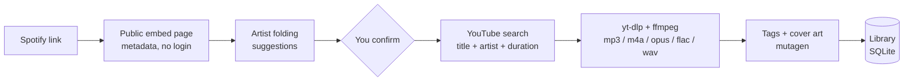

<div align="center">


# Tunefold

**Turn Spotify playlists into neatly tagged audio files. Fold messy artist credits into one clean name.**

[](LICENSE)
[](#build)
[](https://tauri.app)
[](https://react.dev)
[](https://python.org)
[](https://github.com/yt-dlp/yt-dlp)

[Why](#why-tunefold) · [Features](#features) · [How it works](#how-it-works) · [Quick start](#quick-start) · [Build](#build) · [Architecture](#architecture) · [Roadmap](#roadmap)

</div>

---

## Why Tunefold

Spotify credits the same band differently from album to album. Some songs are
filed under **Majke**, others under **Goran Bare, Majke**. Some under **Bijelo
Dugme**, others under **Bijelo dugme**. A guest on one track turns
**Olivia Rodrigo** into **Olivia Rodrigo, Chappell Roan**.

Download that playlist with any ordinary tool and your library, sorted by
artist, is scattered across three folders for one band.

Tunefold reads the playlist first, spots those credits, and **suggests one
canonical name for each artist**. You confirm with a click, rename, or decline.
The decision is remembered and applied to every playlist after that.

<div align="center">

</div>

## Features

- **Playlists, albums and single tracks.** Paste any `open.spotify.com` link or `spotify:` URI. No Spotify account, no API key.
- **Preview before download.** See every track, its credit, the name it will be saved under, and what you already have. Pick exactly what you want.
- **Smart artist folding.** Four kinds of suggestions, all driven by the names people actually see:
  | Kind | Example | Rule |
  | :--- | :--- | :--- |
  | Fold | `Majke` → `Goran Bare, Majke` | a narrower credit is part of a wider one, so everything goes under the wider name (the reverse is one click away) |
  | Guest | `Olivia Rodrigo, Chappell Roan` → `Olivia Rodrigo` | a `(feat. X)` in the title is a guest, not a co-equal artist |
  | Spelling | `Bijelo dugme` → `Bijelo Dugme` | same name, different case, diacritics or punctuation |
  | Saved rule | applied automatically | a decision you made on an earlier playlist |
- **Correct tags, everywhere.** Title, artist, album artist, album, year, track number and front cover, written as ID3v2.3 for MP3 so car head units and old players read them too. The original Spotify credit is kept in a separate tag, so nothing is lost.
- **Accurate matching.** The YouTube upload is chosen by title, artist and duration, not by the first hit. Live versions, remixes and sped-up edits are rejected.
- **Five formats.** MP3, M4A, Opus (128 to 320 kbps) and FLAC or WAV (lossless).
- **Your layout.** One folder per playlist, `Artist/`, or `Artist/Album/`. File names as `Artist - Track`, `Track - Artist` or just `Track`, with optional `01.` prefixes.
- **Resumable.** Tracks already on disk are skipped. Stop any time, retry only what failed.
- **Parallel downloads** with live per-track progress.

<div align="center">

</div>

## How it works

Nothing is downloaded from Spotify. Spotify provides the metadata, YouTube provides the audio.



1. The playlist, album or track is read from Spotify's public embed page. Large playlists are completed through Spotify's own playlist endpoint with the anonymous token that page carries.
2. Artist credits are normalised and compared. Each suggestion lists the tracks it touches and why.
3. For every selected track the best YouTube upload is picked, downloaded, converted, tagged and recorded in the local library so the next playlist knows what you already own.

## Quick start

Prerequisites: [Node 20+](https://nodejs.org), [Rust](https://rustup.rs), Python 3.10+, `ffmpeg` on your PATH.

```bash
git clone https://github.com/hercegman/tunefold.git
cd tunefold
npm install
python -m venv backend/.venv && backend/.venv/bin/pip install -r backend/requirements.txt

./dev.sh          # backend + desktop window with hot reload
./dev.sh web      # same UI in the browser at http://localhost:5173
```

<div align="center">

</div>

## Build

```bash
npm run dist
```

This packages the Python backend into a single binary with PyInstaller, places it
in `src-tauri/binaries/` as a Tauri sidecar, and builds the desktop bundles
(`.deb`, AppImage and `.rpm` on Linux). The app starts the backend itself and
shuts it down with the window.

## Architecture

| Layer | Stack | What it does |
| :--- | :--- | :--- |
| `src/` | React 19, TypeScript, Tailwind 4, lucide | Preview table, folding panel, download view, settings |
| `src-tauri/` | Tauri 2, plugins: shell, dialog, opener, log | Native window, file dialogs, sidecar lifecycle |
| `backend/app/spotify.py` | requests | Embed page parsing, spclient paging, album lookup |
| `backend/app/artists.py` | pure Python | Normalisation, subset folding, feat. detection, spelling unification |
| `backend/app/downloader.py` | yt-dlp, ffmpeg | Search, candidate scoring, download, conversion |
| `backend/app/tags.py` | mutagen | ID3v2.3, MP4, FLAC and Opus tags with cover art |
| `backend/app/library.py` | SQLite | Settings, saved artist rules, download history |
| `backend/app/main.py` | FastAPI, SSE | HTTP API and live progress stream |

The UI talks to the backend over HTTP on `127.0.0.1:8765`. Progress arrives as
server-sent events, one per state change, so the window never polls.

## Roadmap

- [ ] App icon and signed release builds for Linux, macOS and Windows
- [ ] Import an existing music folder and run it through artist folding
- [ ] Per-track cover art in the preview
- [ ] Lyrics and `.lrc` files
- [ ] Drag and drop several links at once

## Legal

Tunefold is a personal tool. Downloading music you do not own from YouTube may
violate the YouTube Terms of Service and copyright law in your country. Use it
only for content you have the right to download.

## License

[MIT](LICENSE)
